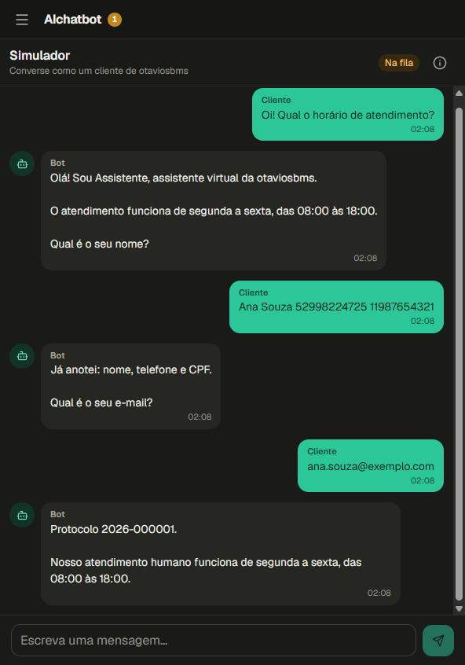
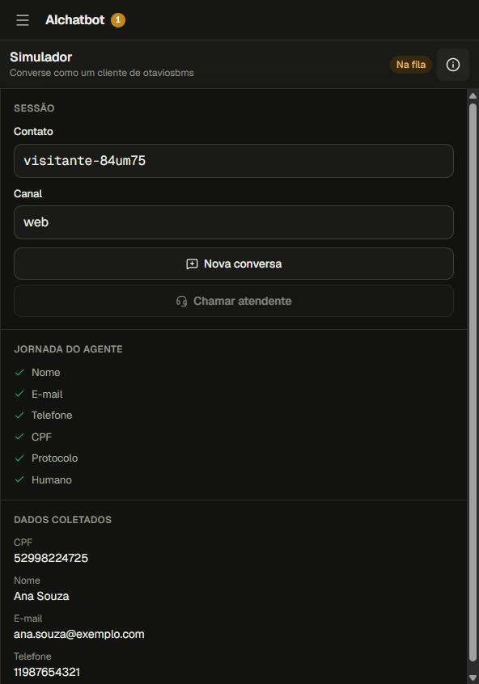
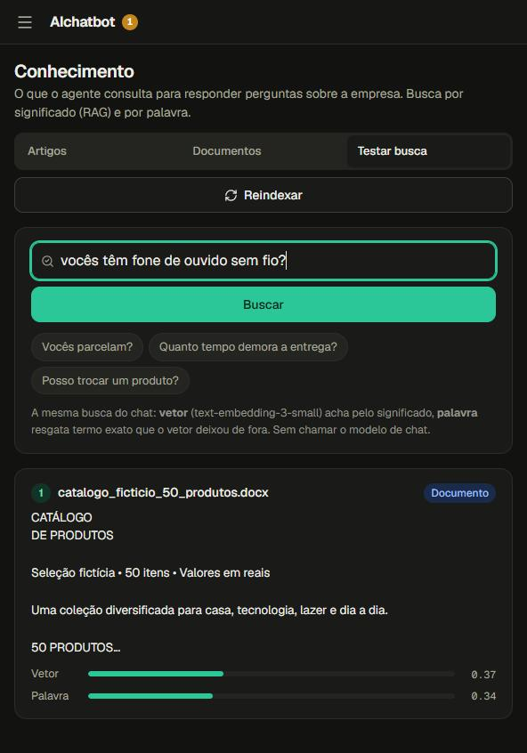
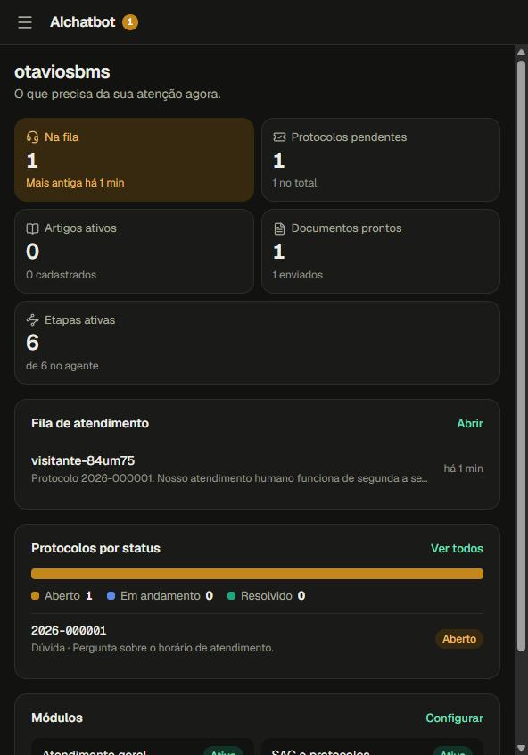
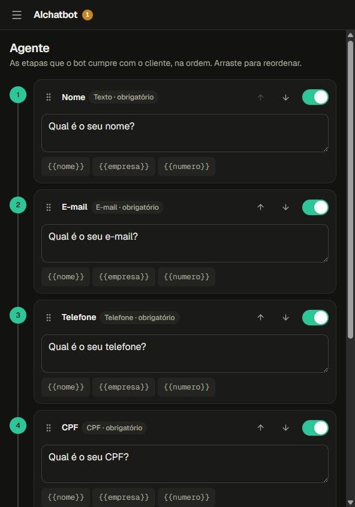

# AIchatbot — painel

Painel em React do AIchatbot, um chatbot de atendimento com agentes de IA, base de conhecimento com RAG e transferência para atendente humano. Projeto de portfólio, feito de ponta a ponta.

**No ar:** https://aichatbot.otaviosbms.com.br · **API:** [ai-chatbot](https://github.com/otaviosbms/ai-chatbot)

<p>
  
  
  
</p>
<p>
  
  
</p>

## Telas

| Tela | O que faz |
| --- | --- |
| Visão geral | Fila, protocolos, base de conhecimento, etapas e módulos da empresa |
| Simulador | Conversa como cliente, com a jornada do agente e os dados coletados a cada mensagem |
| Atendimento | Fila de transferências, resposta, devolução ao bot e encerramento |
| Protocolos | Busca, filtro por status, mudança de status e conversa de origem |
| Conhecimento | Artigos e documentos PDF, DOCX, TXT e MD, com o status da indexação (RAG), os trechos de cada um, remoção, **Testar busca** (as notas de vetor e de palavra de cada trecho) e **Reindexar** |
| Agente | Ordem, mensagem e ativação das etapas |
| Configurações | Os quatro módulos: persona, SAC, transferência e busca |

## Stack

React 19, Vite, React Router, Lucide e fontes Geist. Sem biblioteca de componentes nem cliente GraphQL: as chamadas ficam em `src/api.js`, com `fetch`. Lint com oxlint.

## Rodando

```bash
npm install
cp .env.example .env   # ajuste VITE_API_URL se necessário
npm run dev
```

A API precisa estar em `http://localhost:3000/graphql` (padrão). Veja como subir a API no [README dela](https://github.com/otaviosbms/ai-chatbot#rodando).

## Login

O painel abre na tela de **Entrar** (e-mail e senha). A conta pertence a uma empresa e o painel cai direto nela, sem digitar ID. O token fica no `localStorage` (`chatbot-sessao`) e vai em `Authorization: Bearer`; se a API o recusar, volta para o login. **Criar uma conta** aparece enquanto a API estiver com o cadastro aberto (`REGISTRO_ABERTO`, padrão `true`); para contas de empresas que já existem, use `npm run usuario:criar` na API ([docs/17](https://github.com/otaviosbms/ai-chatbot/blob/main/docs/17-autenticacao.md)). O menu da empresa, no topo da barra lateral, tem **Copiar ID da empresa** (usado por quem integra o canal de atendimento) e **Sair**.

## Chave da OpenAI

Quem decide é a API, pela variável `LLM_MODO` do `.env` dela. O painel consulta a query `configuracaoLlm` ao abrir.

| Modo | O que acontece |
|---|---|
| `servidor` (padrão) | A API usa `LLM_API_KEY` e `LLM_MODEL` do `.env`. O painel abre direto e mostra o modelo no menu. |
| `cliente` | O painel pede a chave da OpenAI de quem usa e o modelo, antes de abrir. A chave do `.env` nunca é usada. Bom para publicar o projeto sem gastar a sua chave. |

No modo cliente:

- A chave é conferida na API (`modelosLlm`), que lista só os modelos de chat liberados para ela.
- Ela fica só no navegador: na sessão por padrão, ou no armazenamento local com "Lembrar neste navegador". "Trocar", no menu, apaga a chave.
- Ela vai para a API em cada requisição, nos cabeçalhos `x-llm-api-key` e `x-llm-model`, e não é gravada no servidor.

## O que fica só no navegador

A API não tem consulta para estes dados, então eles ficam no `localStorage`:

- **Chave e modelo da OpenAI:** veja a seção acima.
- **Conversas "Comigo":** `conversasAguardandoHumano` só traz a fila. Depois da primeira resposta, a conversa só aparece no navegador do atendente que respondeu.

## Licença

[MIT](LICENSE)
